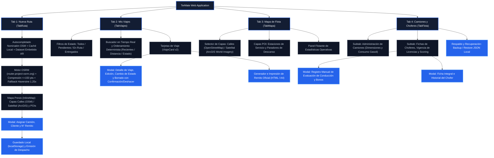
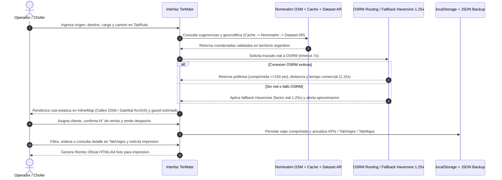
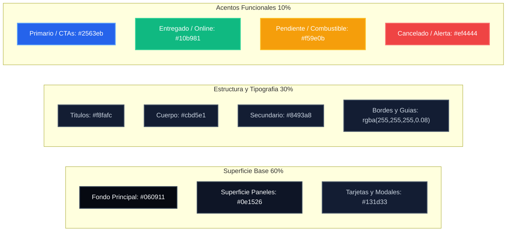
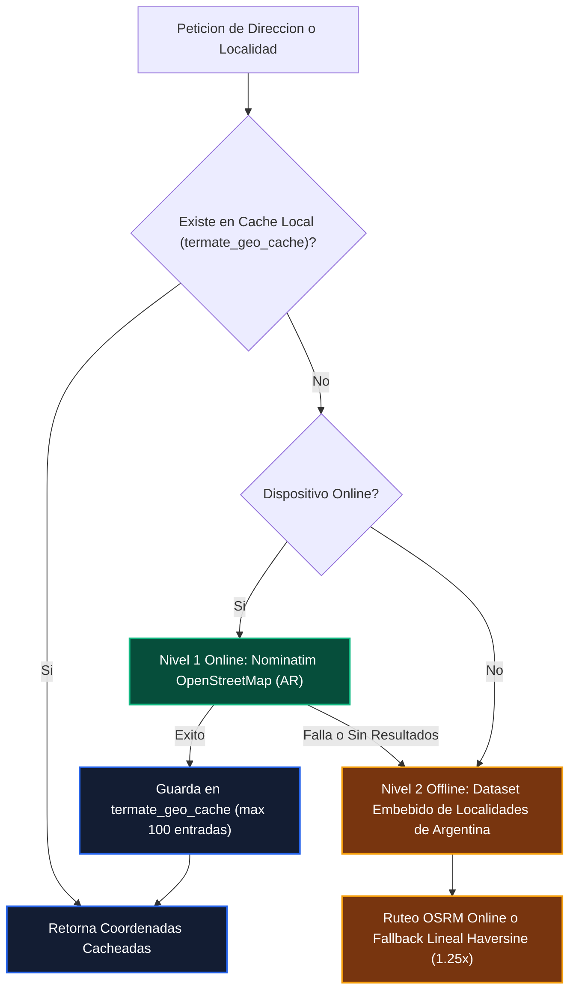

# TerMate Design System & Arquitectura de Interfaz

## 1. Visión y Filosofía de Producto
TerMate es la plataforma de gestión logística, trazado de rutas de transporte pesado y emisión digital de remitos en la República Argentina.
Diseñada bajo principios **Mobile-First**, ergonomía táctil para choferes en cabina, visualización integral para operadores logísticos de escritorio y una identidad visual **Obsidian & Electric Blue** de alto contraste.

---

## 2. Flujo Integral de Pantallas (Screen Flow Architecture)

### Detalle Operativo por Pantalla (`TabRuta`, `TabViajes`, `TabMapa`, `TabFlota`)
- **`TabRuta` (Nueva Ruta y Previsualización `InlineMap`)**:
  - **Autocompletado y Geocodificación**: Consulta en vivo a **Nominatim OpenStreetMap** acotado a Argentina (`countrycodes=ar`), respaldado por caché persistente (`termate_geo_cache`) y fallback inmediato al **Dataset Embebido de Localidades de Argentina** en `js/app.js`. *(Nota arquitectónica: Aunque `sw.js` contempla orígenes como `apis.datos.gob.ar` [GeoRef] y `api.openrouteservice.org` [ORS] en su lista de red, el runtime actual de `js/app.js` no los invoca).*
  - **Cálculo de Ruta**: Consulta a **OSRM (`router.project-osrm.org`)** con factor de ajuste de tiempo comercial para transporte pesado (`1.15x`), compresión de polilínea (`<= 150 puntos`) para proteger la cuota de `localStorage`, y cálculo de consumo de gasoil interpolado según el peso de la carga y el camión asignado. Cuando no hay señal o OSRM no responde, opera el fallback offline mediante cálculo lineal **Haversine** con coeficiente vial (`1.25x`) y velocidad media estimada (`70 km/h`).
  - **Mapa de Previsualización (`InlineMap`)**: Incluye selectores de capa **Calles (OpenStreetMap estándar)** y **Satelital (ArcGIS World Imagery)**, además de interruptores de POIs (**Estaciones** y **Paradores**). Los marcadores de origen y destino son estáticos de visualización (no arrastrables en vivo).
- **`TabViajes` (Mis Viajes y Remitos)**:
  - **Búsqueda, Filtros y Ordenamiento**: Buscador en tiempo real (por origen, destino, carga, cliente o número de remito), filtros por estado (`Todos`, `Pendientes`, `En Ruta`, `Entregados`) y ordenamiento determinista (por recientes, distancia o estado).
  - **Gestión del Despacho**: Vista detallada en modal, rotación de estados operativos, edición completa, borrado con confirmación/deshacer y generación de **Remito Oficial imprimible en formato HTML/A4** (documento limpio con firmas de chofer y receptor, sin códigos QR ni códigos de barras simulados).
- **`TabMapa` (Mapa de Flota / Operaciones)**:
  - **Capas Base Permitidas**: Selector entre **Calles (OpenStreetMap estándar)** y **Satelital (ArcGIS World Imagery)**.
  - **Superposiciones Operativas**: Buscador geográfico integrado en el mapa, activación de POIs ruteros (**Estaciones de Servicio** y **Paradores y Descansos**), trazado de todas las rutas activas codificadas por color de estado y panel flotante de métricas (`Rutas en Mapa`, `En Ruta`, `Distancia Total`).
- **`TabFlota` (Camiones y Choferes)**:
  - **Administración de Camiones**: Alta, edición y baja con desvinculación en cascada y preservación de snapshot histórico en viajes; configuración de patente, chofer habitual, peso máximo, dimensiones (`alto`, `largo`, `ancho`) y consumo de gasoil (`vacío` y `a plena carga` en L/100km).
  - **Fichas de Choferes y Licencias**: Gestión de datos personales, certificaciones/capacitaciones y control automático de estado de licencia profesional (**vencida**, **próxima a vencer en 30 días**, **vigente** o **fecha sin registrar**).
  - **Evaluación de Conducción y Respaldo**: Registro manual de evaluaciones de desempeño por viaje (cumplimiento de ruta, puntualidad, incidencias y asignación de bonos) con anillo visual de scoring (`0% - 100%`), complementado con **Backup/Restore JSON local** para resguardo y restauración íntegra de datos.

---

## 3. Flujo de Usuario (User Journey Map)

---

## 4. Sistema de Color y Tokens — Obsidian & Electric Blue (Regla 60 / 30 / 10)

---

## 5. Arquitectura de Geocodificación y Resiliencia Offline

> [!NOTE]
> **Alcance en Runtime vs. Service Worker (`sw.js`)**: El motor activo en `js/app.js` resuelve direcciones exclusivamente mediante `termate_geo_cache`, **Nominatim OpenStreetMap** y el **Dataset Embebido de Localidades de Argentina**. Aunque `sw.js` declara reglas de intercepción *Network-First* para dominios como `apis.datos.gob.ar` (GeoRef) o `api.openrouteservice.org` (ORS), dichos servicios se mantienen como previsión de infraestructura en el Service Worker y no son consumidos por `js/app.js`.

---

## 6. Capacidades Operativas Verificadas vs. Capacidades Fuera de Alcance / Aspiracionales

Para evitar divergencias entre el diseño documental y la evidencia del código en producción (`index.html`, `js/app.js`, `css/styles.css`, `sw.js`), se establece la siguiente matriz de verdad operativa:

| Dominio | Capacidades Operativas Verificadas (Runtime Actual) | Capacidades Fuera de Alcance / Aspiracionales (No en Runtime) |
| :--- | :--- | :--- |
| **Geocodificación** | Autocompletado y resolución con **Nominatim OpenStreetMap** (`countrycodes=ar`), caché persistente (`termate_geo_cache`) y fallback al **Dataset Embebido de Localidades de Argentina**. | Integración activa en `js/app.js` con **GeoRef AR** (`apis.datos.gob.ar`), **OpenRouteService (ORS)** o **SerpApi Google Maps**. |
| **Motor de Ruteo** | Cálculo vial mediante **OSRM (`router.project-osrm.org`)** con ajuste de tiempo comercial (`1.15x`), compresión de polilínea (`<= 150 puntos`) y fallback offline **Haversine (`1.25x`)**. | Ruteo **HGV** con restricciones viales activas por dimensiones físicas (altura de puentes, ancho, largo) o peso máximo por eje. |
| **Mapas e Interacción** | Doble instancia Leaflet (`TabMapa` e `InlineMap`) con capas **Calles (OpenStreetMap estándar)** y **Satelital (ArcGIS World Imagery)**, más POIs locales de **Estaciones** y **Paradores**. | **Marcadores arrastrables** con recálculo de ruta en vivo y **seguimiento GPS / telemetría en tiempo real**. |
| **Viajes y Remitos** | Búsqueda en vivo, filtros por estado (`Todos`, `Pendientes`, `En Ruta`, `Entregados`), ordenamiento determinista, detalle modal, borrado con confirmación/deshacer y **Remito Oficial HTML/A4**. | Impresión térmica ESC/POS dedicada o inclusión de **códigos QR / códigos de barras** dinámicos en el remito impreso. |
| **Flota y Choferes** | ABM de camiones y choferes, control de vencimiento de licencias (vencida, próxima en 30 días, vigente, sin fecha), scoring por evaluación manual de viajes y **Backup/Restore JSON local**. | Sincronización automática en la nube multi-dispositivo o ingesta telemática automática de conducción. |

---

## 7. Jerarquía de Aislamiento Visual (Z-Index)
- `Header y Sidebar`: `z-index: 5000` (Fijos y visibles siempre por encima del contenido).
- `Bottom Navigation Bar`: `z-index: 5000` (Ergonomía táctil fija en la base de la pantalla sin superposiciones).
- `Modales y Diálogos`: `z-index: 9000` (Aislamiento completo sobre la capa de trabajo).
- `Notificaciones Toast`: `z-index: 9999` (Feedback de sistema en primer plano).
- `Capas de Mapa Leaflet`: `z-index: 5` a `25` (Contenidas estrictamente dentro de su contenedor).
