# TerMate: informe de mejoras de interfaz, uso y confiabilidad

**Fecha del informe:** 11 de noviembre de 2026  
**Alcance de la comparación:** Evolución en tres etapas verificadas en el repositorio:
1. **`main` previo (`5f4bbeb`)**: punto de partida anterior a la auditoría.
2. **Rama `fix/mejoras-auditoria` (`d34667a`)**: corrección de mapas, protección frente a datos incompletos, compresión de recorridos y mejoras iniciales de teclado y borrado seguro.
3. **Rama `MejorasUIyUX` (`a4a0955`)**: rediseño de uso cotidiano, edición y cambio de estado desde el detalle del despacho, borrado recuperable durante 15 segundos para viajes, camiones y choferes, validaciones junto a cada campo, borrador automático de rutas, alertas de licencias y copias de seguridad en archivo JSON. Esta rama ya fue subida al repositorio remoto (`origin/MejorasUIyUX`), quedando pendiente únicamente su fusión final en `main`.

---

## 1. Cambios visuales y de uso de la interfaz

### Mapa principal y vista previa de ruta
- **Reemplazo de mapas que fallaban (`fix/mejoras-auditoria`):** En `main`, el mapa utilizaba el proveedor CARTO, que mostraba el aviso *"API KEY REQUIRED"* y bloqueaba la visualización de las calles. Se reemplazó por **OpenStreetMap** para la vista de calles y **ArcGIS** para la vista satelital, ambos sin requerir clave de CARTO.
- **Controles visibles en ambos mapas (`fix/mejoras-auditoria` y `MejorasUIyUX`):** Tanto el mapa de flota como la vista previa de **Nueva Ruta** cuentan con botones directos para alternar entre **Calles** y **Satelital**, y para mostrar u ocultar **Estaciones de Servicio** y **Paradores y Descansos**.
- **Interfaz del mapa más limpia (`MejorasUIyUX`):** En el mapa de flota se retiró el buscador superior que se superponía con el mapa, se centraron los controles principales arriba y se incorporó abajo a la derecha una guía visual de colores para identificar de un vistazo los despachos **Pendientes**, **En ruta** y **Entregados**, además de encuadrar automáticamente las rutas activas al abrir la pestaña.

| Área | Antes (`main` — `5f4bbeb`) | Después (`MejorasUIyUX` — `a4a0955`) |
|---|---|---|
| **Mapa de Flota y controles** | 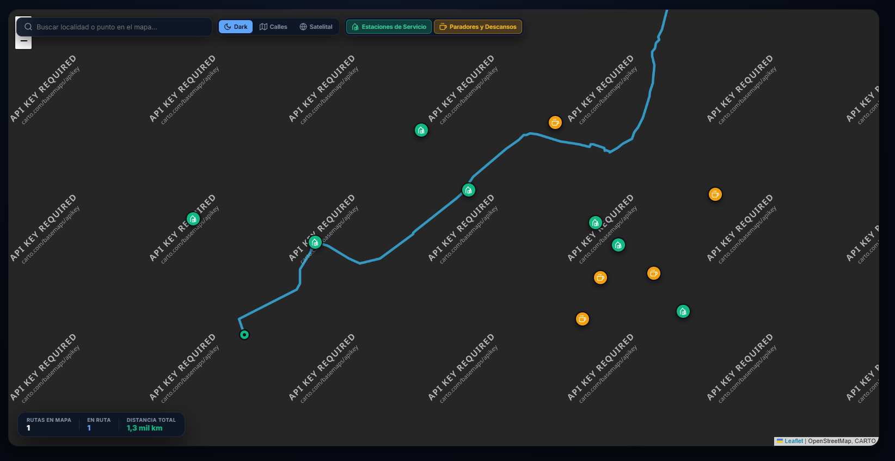 | 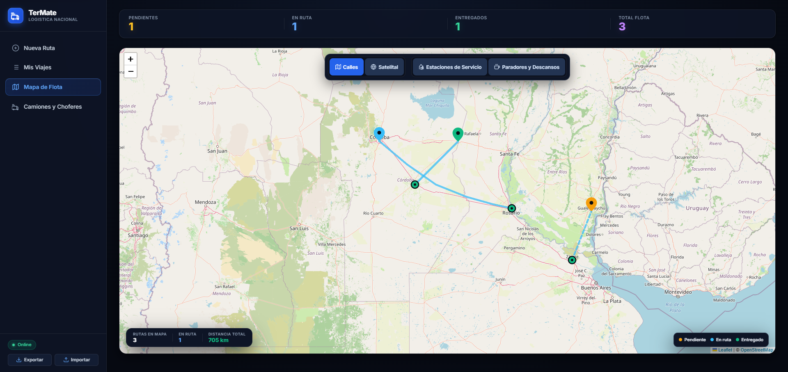 |
| **Vista previa en Nueva Ruta** | 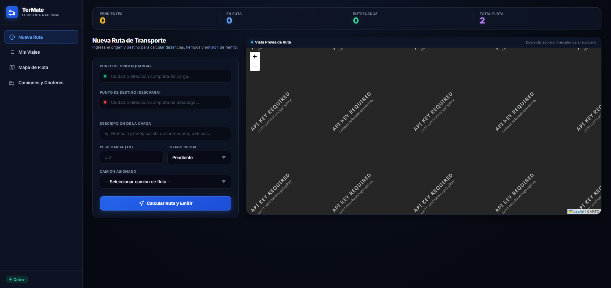 | 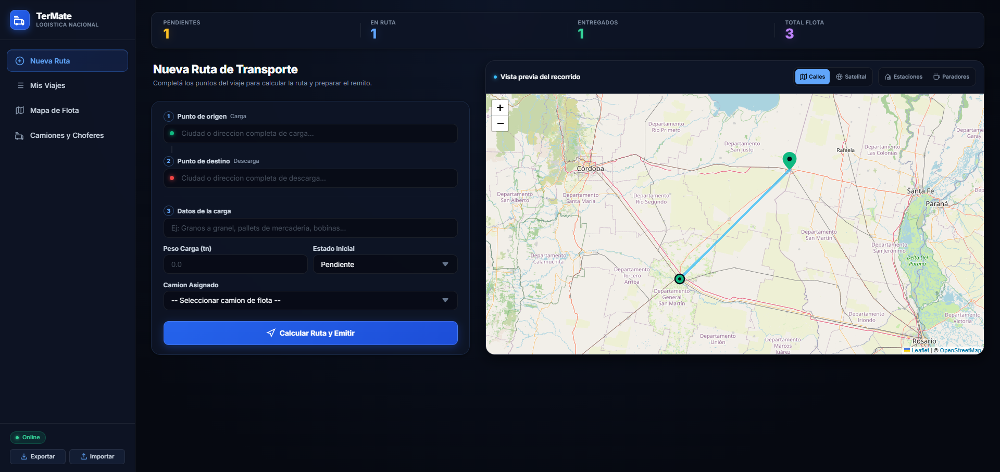 |

*Pie de comparación:* En `main` (capturas recuperadas del historial de sesiones previas), los mosaicos de CARTO quedaban bloqueados pidiendo clave de API. En `fix/mejoras-auditoria` se restableció el mapa con OpenStreetMap y ArcGIS, y en `MejorasUIyUX` se centraron los controles y se sumó la leyenda de estados por color.

---

### Lista de viajes, estados vacíos y vista de detalle del despacho
- **Ordenamiento y filtros claros (`MejorasUIyUX`):** En **Mis Viajes y Remitos** se incorporó un selector para ordenar los despachos por **Más recientes**, **Más antiguos**, **Mayor distancia**, **Menor distancia** o **Por estado**, manteniendo los filtros rápidos (*Todos*, *Pendientes*, *En Ruta*, *Entregados*) y el buscador.
- **Mensajes diferenciados cuando no hay viajes (`MejorasUIyUX`):** La pantalla distingue cuando todavía no se cargó ningún despacho (ofreciendo un botón directo para crear el primero) de cuando una búsqueda o filtro puntual no encuentra coincidencias (ofreciendo limpiar los filtros con un clic).

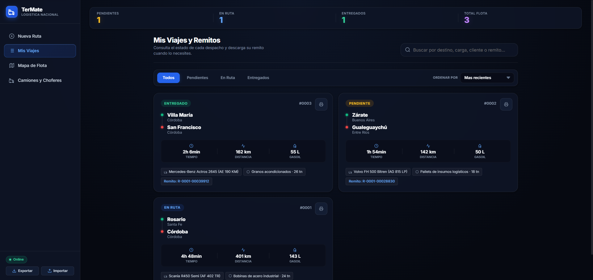

- **Detalle del despacho renovado (`MejorasUIyUX`):** Al abrir un viaje se muestra toda su información operativa ordenada en tarjetas (origen, destino, carga, peso, distancia, tiempo, consumo estimado, estado, camión asignado, chofer, cliente y número de remito).
- **Cambio de estado y edición sin salir de la ventana (`MejorasUIyUX`):**
  - El botón **Cambiar estado** despliega un selector dentro de la misma ventana para elegir *Pendiente*, *En Tránsito* o *Entregado* y guardarlo con **Actualizar estado** sin cerrar el detalle.
  - El botón **Editar** abre el formulario de edición dentro de la misma ventana emergente. Mientras ese formulario está abierto, hacer clic fuera de la ventana o presionar `Escape` no la cierra por accidente, evitando perder cambios sin guardar.
  - Las acciones para **Ver en mapa** y **Eliminar** quedaron ubicadas juntas en la fila inferior con tamaño amplio y claro.

| Vista en `MejorasUIyUX` (`a4a0955`) | Captura verificada |
|---|---|
| **Detalle del despacho y botonera reorganizada** | 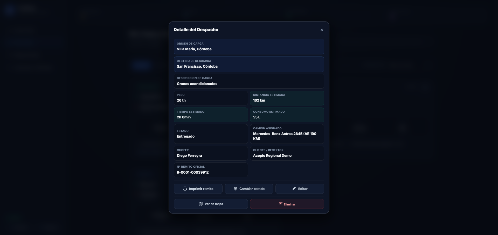 |
| **Cambio de estado dentro del detalle** | 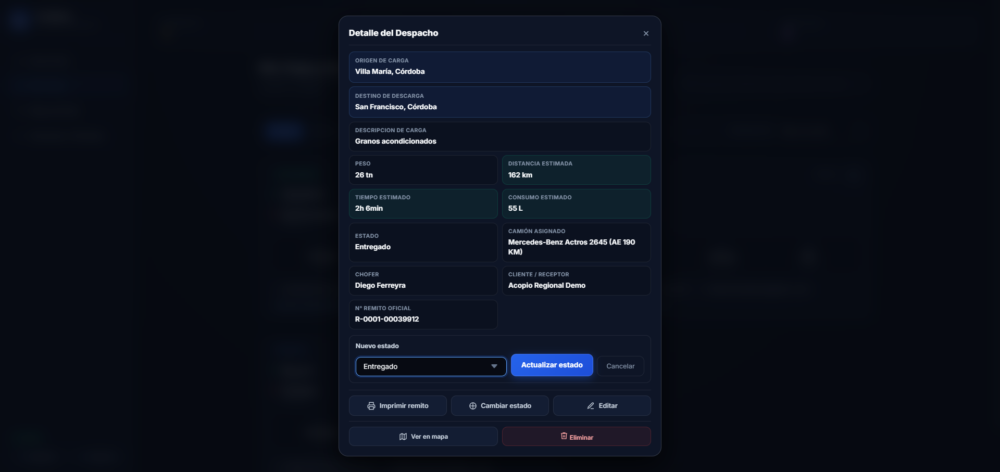 |
| **Edición directa en la misma ventana** | 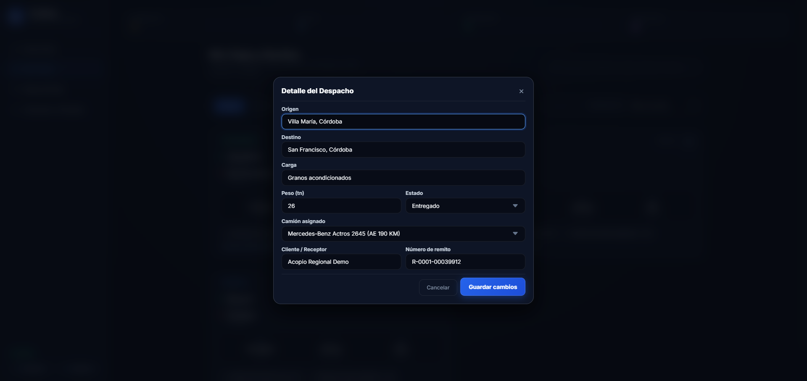 |

---

## 2. Acciones más seguras y recuperables

- **Confirmación clara antes de borrar (`fix/mejoras-auditoria` y `MejorasUIyUX`):** En lugar de eliminar registros de forma inmediata o con avisos genéricos del navegador, TerMate abre una ventana de confirmación propia que explica qué registro se va a borrar y qué asignaciones se verán afectadas (por ejemplo, cuántos viajes conservan el nombre histórico del camión pero quedan sin unidad activa, o de qué camión se desvincula un chofer).
- **Opción "Deshacer" durante 15 segundos (`MejorasUIyUX`):** Al confirmar el borrado de un **viaje**, un **camión** o un **chofer**, el sistema muestra un aviso en la esquina inferior derecha con el botón **Deshacer** activo durante **15 segundos**. Si la persona pulsa *Deshacer* dentro de ese plazo, el registro y sus vínculos previos se restauran de inmediato.
- **Alcance temporal:** Esta recuperación es una red de seguridad inmediata de 15 segundos en la sesión actual; no es una papelera permanente.

| Acción de borrado y recuperación (`MejorasUIyUX`) | Captura verificada |
|---|---|
| **Confirmación al eliminar un despacho** | 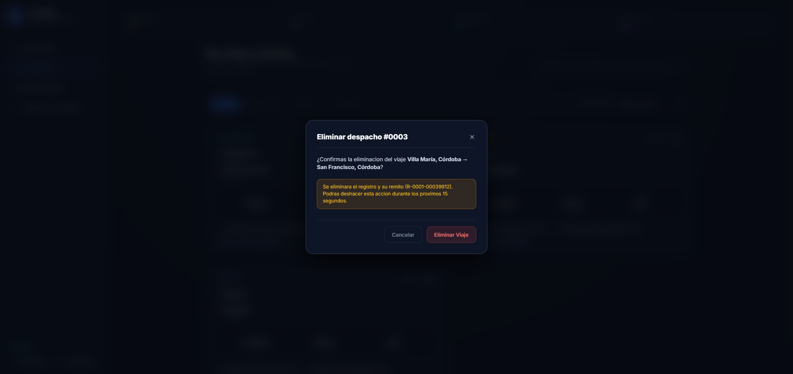 |
| **Aviso "Deshacer" tras eliminar un despacho (15 s)** | 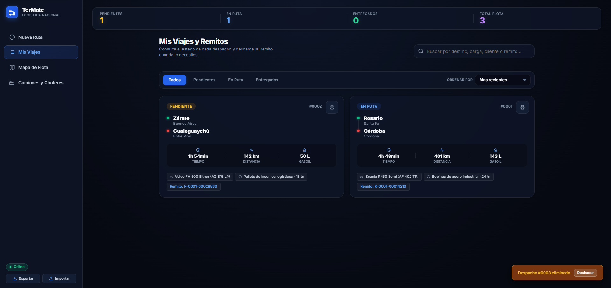 |
| **Confirmación con impacto en relaciones al eliminar un camión** | 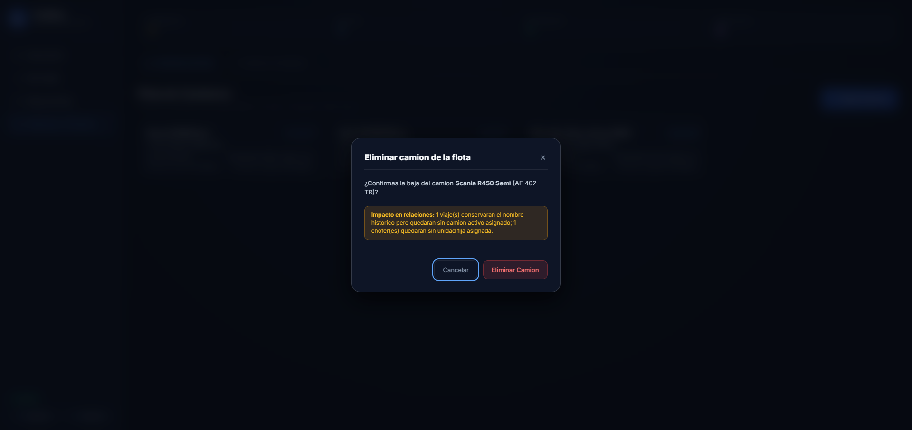 |
| **Aviso "Deshacer" tras eliminar un camión (15 s)** |  |
| **Confirmación con impacto en relaciones al eliminar un chofer** | 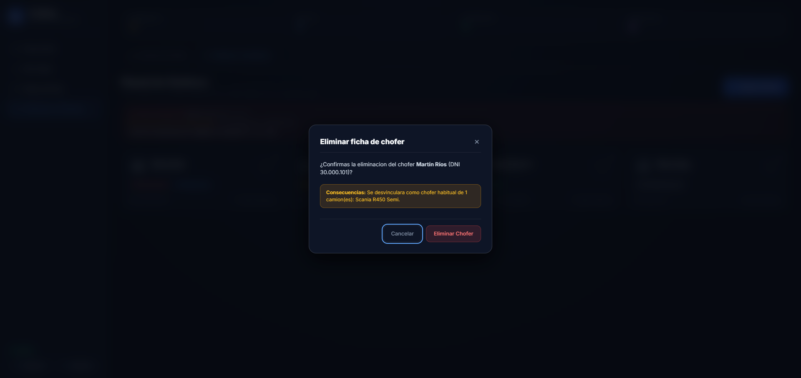 |
| **Aviso "Deshacer" tras eliminar un chofer (15 s)** |  |

---

## 3. Formularios, borradores y control de licencias

- **Mensajes de corrección junto a cada campo (`MejorasUIyUX`):** Si falta completar un dato obligatorio o un valor no es válido (como origen, destino, descripción de la carga, patente o capacidad), el formulario marca el campo en rojo, muestra debajo qué se debe corregir y lleva el cursor directamente al primer campo con error.
- **Guardado automático de borrador en Nueva Ruta (`MejorasUIyUX`):** Mientras se escribe una ruta nueva, TerMate guarda automáticamente un borrador local. Si la página se cierra o recarga antes de emitir el viaje, al volver aparece un aviso (*"Borrador recuperado automáticamente"*) con los datos listos para retomarlos o descartarlos con un botón.
- **Alertas y estados de licencias de choferes (`MejorasUIyUX`):** En la pestaña **Choferes y Conducta**, un cuadro superior resume qué conductores tienen la licencia vencida, próxima a vencer (en 30 días o menos) o sin fecha registrada. Además, cada tarjeta identifica visualmente los cuatro estados posibles: **Licencia Vencida** (rojo), **Vence en ≤30d** (ámbar), **Vigente** (verde) y **Sin fecha vto.** (gris con borde punteado).

| Mejora en formularios y plantel (`MejorasUIyUX`) | Captura verificada |
|---|---|
| **Errores explicados debajo de cada campo** | 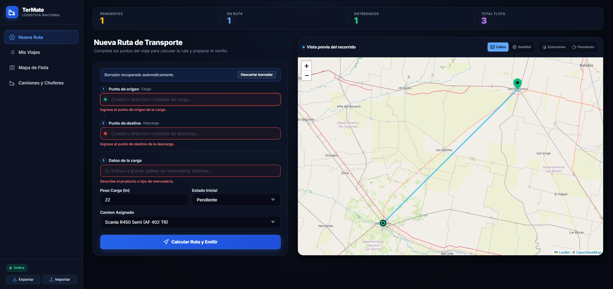 |
| **Recuperación automática de borrador de ruta** | 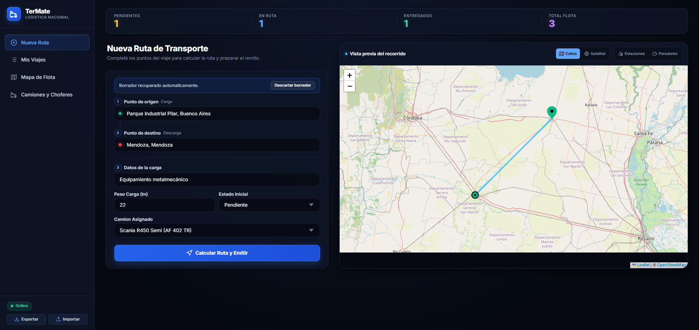 |
| **Alertas superiores y etiquetas de licencias de choferes** |  |

---

## 4. Copias de seguridad de los datos

- **Exportar e importar desde el menú (`MejorasUIyUX`):** En la barra lateral (y en la vista móvil) se sumaron los botones **Exportar** e **Importar** para descargar todos los viajes, camiones y choferes en un archivo `.json` en el dispositivo o recuperarlos más adelante.
- **Revisión previa y resguardo ante fallos (`MejorasUIyUX`):** Antes de reemplazar la información actual, TerMate verifica que el archivo sea válido, controla que las referencias entre viajes, camiones y choferes sean coherentes y muestra una ventana con el **resumen del respaldo** (fecha de exportación y cantidad de viajes, camiones y choferes). Si durante la carga ocurriera un problema de espacio en el navegador, el sistema intenta restaurar automáticamente los datos anteriores.
- **Alcance local:** La copia se guarda como un archivo en el dispositivo; no sincroniza datos automáticamente en la nube ni entre distintos equipos.

| Respaldo y restauración (`MejorasUIyUX`) | Captura verificada |
|---|---|
| **Botones Exportar e Importar en la barra lateral** | 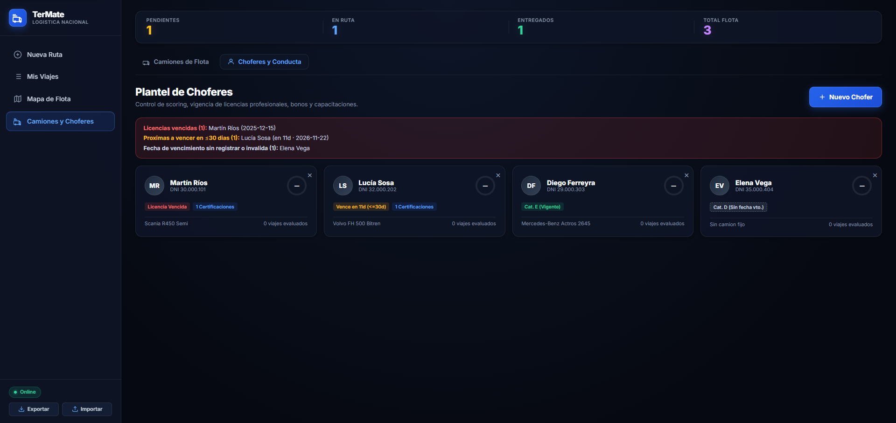 |
| **Resumen de verificación antes de restaurar una copia** | 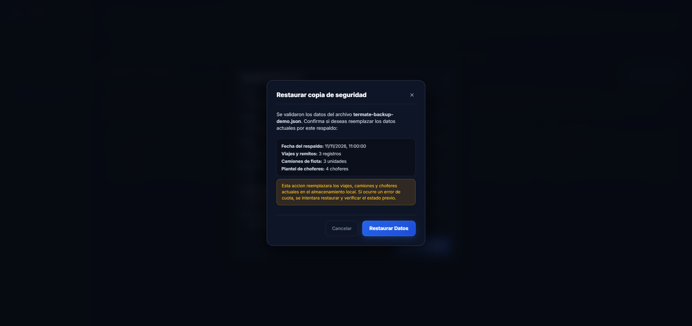 |

---

## 5. Confiabilidad y funcionamiento del mapa y los datos

- **Protección frente a datos dañados (`fix/mejoras-auditoria`):** Si el almacenamiento del navegador contiene registros vacíos o incompletos, la aplicación los filtra al iniciar para evitar que la pantalla quede en blanco.
- **Validación y compresión de rutas (`fix/mejoras-auditoria`):** Antes de dibujar en el mapa, se comprueba que cada coordenada sea válida y esté dentro del rango geográfico de Argentina. Además, los trazados largos se simplifican a un máximo de 150 puntos por ruta para no agotar la memoria del navegador.
- **Reutilización sin conexión y recarga limpia en desarrollo (`fix/mejoras-auditoria` y `MejorasUIyUX`):** El sistema guarda en caché las partes del mapa y las rutas ya consultadas para poder reutilizarlas si se corta la conexión, mientras que en el entorno local (`localhost`) consulta siempre los archivos actualizados para no mostrar versiones viejas.

---

## 6. Accesibilidad y adaptación

- **Uso completo con teclado (`fix/mejoras-auditoria` y `MejorasUIyUX`):** Se agregó un enlace inicial para **Saltar al contenido principal**, las tarjetas de viajes, camiones y choferes se pueden abrir con `Enter` o `Espacio`, y las ventanas emergentes mantienen el foco del teclado dentro de ellas y devuelven el cursor al botón original al cerrarse.
- **Adaptación visual y de movimiento (`MejorasUIyUX`):** Se ajustaron tamaños de botones para pantallas táctiles y móviles, y se respetan las preferencias del sistema operativo cuando la persona usuaria activa la opción de reducir animaciones.

---

## 7. Documentación y mantenimiento del proyecto

- Se actualizaron las guías internas de diseño (`DESIGN.md`) y de trabajo del proyecto (`AGENTS.md`) para dejar documentados los colores, componentes, reglas de mapas libres (OpenStreetMap y ArcGIS) y controles de seguridad. Esto facilita que cualquier mejora futura mantenga la misma apariencia y no reintroduzca errores ya corregidos.

---

## 8. Verificaciones y límites

### Qué se verificó automáticamente
- **Comprobación de sintaxis:** `node --check js/app.js` y `node --check sw.js` finalizaron sin errores.
- **Suite de certificación automatizada (`node tests/certificacion_final_ciclo4.js`):** **31 pruebas aprobadas, 0 fallidas y 0 advertencias** (incluyendo pruebas de datos corruptos, compresión de rutas, coordenadas fuera de rango y seguridad frente a inyección de código).
- **Formato de repositorio (`git diff --check`):** Sin errores de formato ni conflictos.

### Qué se comprobó visualmente en navegador real
- Se levantó el servidor local en `http://localhost:8000` y se verificaron e fotografiaron en navegador real las pantallas de **Nueva Ruta**, **Mapa de Flota** (con rutas encuadradas y paradas activas), **Mis Viajes y Remitos** (con ordenamiento y búsqueda sin resultados), **Detalle del Despacho** (cambio de estado in-situ y edición protegida), **Confirmaciones y avisos "Deshacer"** en viajes, camiones y choferes, **Errores de formulario**, **Borrador recuperado**, **Alertas de licencias** y **Resumen de restauración de copia de seguridad**.

### Límites a tener en cuenta
- Los datos y las copias de seguridad viven en el navegador y en los archivos descargados en cada dispositivo; no existe sincronización automática entre distintos dispositivos.
- El cálculo de rutas nuevas y la carga de sectores del mapa no visitados previamente requieren conexión a internet.

---

## 9. Estado de publicación y cierre

| Etapa | Qué incluye | Estado respecto de `main` |
|---|---|---|
| **`main` previo (`5f4bbeb`)** | Base de comparación anterior a la auditoría | Publicado en `origin/main` |
| **`fix/mejoras-auditoria` (`d34667a`)** | Reemplazo de CARTO por OpenStreetMap/ArcGIS, compresión de rutas, validación de coordenadas, resguardo de datos locales y suite de 31 pruebas | Publicado en `origin/fix/mejoras-auditoria` (incluido íntegramente dentro de `MejorasUIyUX`) |
| **`MejorasUIyUX` (`a4a0955`)** | Edición y cambio de estado en el detalle del viaje, leyenda y controles centrados en el mapa, opción Deshacer (15 s) en viajes/camiones/choferes, validación por campo, borrador de ruta, alertas de licencias y copias de seguridad JSON | **Subido a `origin/MejorasUIyUX`** (pendiente de fusionar mediante Pull Request a `main`) |
